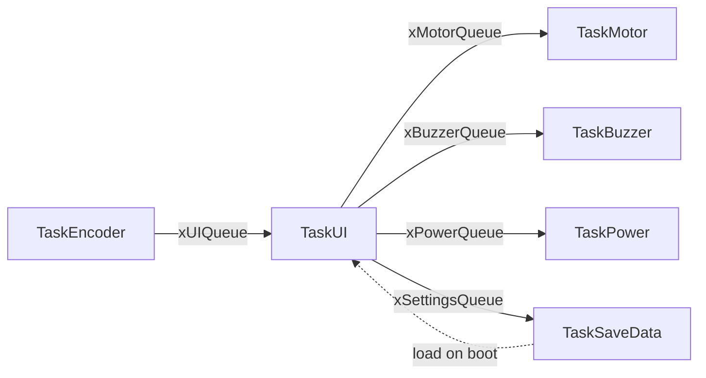

# BioGelato

Embedded firmware for a commercial peristaltic dosing controller, built on the ESP32-S3 with a FreeRTOS task/queue architecture.

## Overview

BioGelato is the control system for a peristaltic-pump dosing appliance: a TFT + rotary-encoder HMI drives motor speed/timing, cleaning cycles, and persisted user settings.

**MCU / framework:** ESP32-S3-WROOM-1-N8R8 (`esp32-s3-devkitc-1`), Arduino framework, FreeRTOS
**Display:** ST7735 128×160 TFT over SPI (`TFT_eSPI`)
**Input:** ALPS EC11 rotary encoder with push button
**Output:** Passive piezo buzzer, PWM motor driver
**Build system:** PlatformIO

## Features

- **Dosing control** — continuous-speed mode and timed "drip" mode, with speed mapped hyperbolically to pulse period for fine low-flow control
- **Cleaning cycles** — fast, slow, and purge profiles for line cleaning between doses
- **Menu-driven UI** — rotary-encoder navigation with dynamic step acceleration (step size ramps 1→2 on fast consecutive ticks, resets on pause)
- **Persistent settings** — motor speed and timer index survive power cycles via NVS (`Preferences`, namespace `appcfg`)
- **Power management** — deep-sleep shutdown with wake-on-button (`EXT0`), backlight and motor forced off before sleep
- **Audible feedback** — melody playback for confirmations, errors, and limit warnings

## Hardware

| Signal | GPIO |
|---|---|
| Encoder CLK | 11 |
| Encoder DT | 10 |
| Encoder SW (button) | 12 |
| Motor PWM | 21 |
| Buzzer | 47 |
| TFT backlight | 2 |
| TFT MOSI / SCLK / CS / DC / RST / MISO | 42 / 41 / 40 / 39 / 38 / 1 |

Encoder CLK/DT use external pull-ups on the PCB (`INPUT`, not `INPUT_PULLUP`); the button uses `INPUT_PULLUP`. The TFT backlight is active-HIGH.

## Firmware Architecture

All inter-task coordination is queue-based — no task reads or writes another task's state directly.



| Task | Stack | Priority | Role |
|---|---|---|---|
| `TaskEncoder` | 4096 | 1 | Polls EC11 every 1 ms (quadrature decode), posts events to `xUIQueue` |
| `TaskUI` | 4096 | 1 | Drains `xUIQueue`, coalesces rotation deltas, drives the UI state machine |
| `TaskMotor` | 4096 | 1 | Sole owner of motor LEDC/timer state; executes queued commands |
| `TaskBuzzer` | 2048 | 1 | Plays melodies to completion, blocking on `xBuzzerQueue` |
| `TaskSaveData` | 2048 | 1 | NVS read/write for persisted settings |
| `TaskPower` | 2048 | 2 | Shutdown sequence and deep-sleep entry |

## Getting Started

```bash
# Build
pio run

# Build and flash
pio run --target upload

# Serial monitor
pio device monitor
```

> **TFT_eSPI configuration lives entirely in `platformio.ini`**, not in the library's `User_Setup.h`, via `-DUSER_SETUP_LOADED`. This keeps the build flags as the single source of truth and makes the config survive a clean `TFT_eSPI` reinstall.

## Project Structure

```
include/
  Config/        # Pin definitions, queue/task declarations
  Tasks/         # Task headers
  UI/            # UI state machine header
src/
  Config/        # Queue/task initialization
  Tasks/         # Task implementations (Encoder, UI, Motor, Buzzer, SaveData, Power)
  UI/            # UI rendering and state table
  images/        # Icon assets for the TFT UI
platformio.ini   # Board, framework, and TFT_eSPI build-flag configuration
```

## Status / Roadmap

- Firmware: feature-complete, hardware-validated, under active refinement
- Enclosure: 3D-printed housing in development (FreeCAD) for the pump and HMI panel